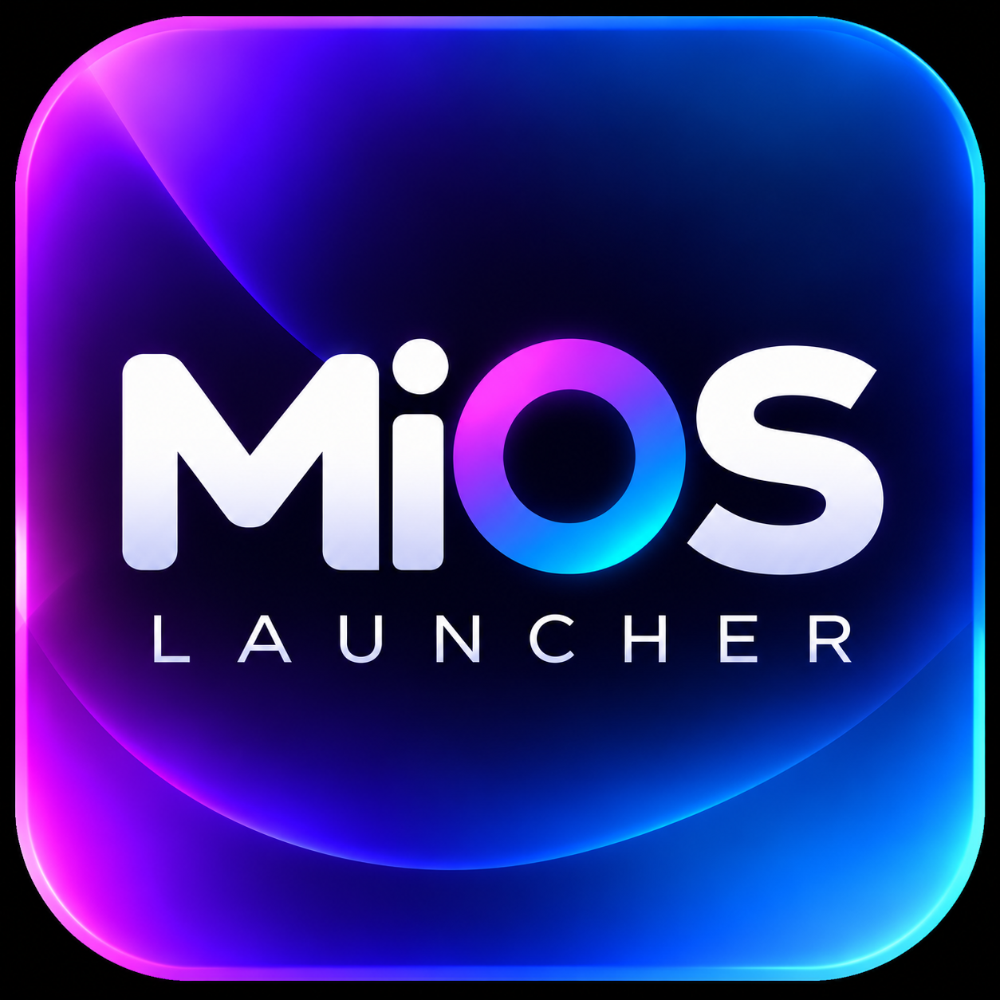
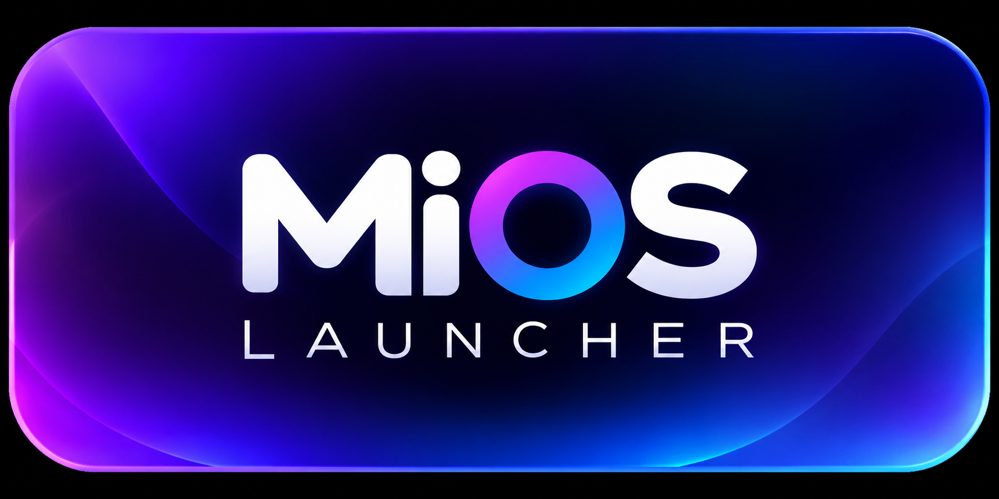
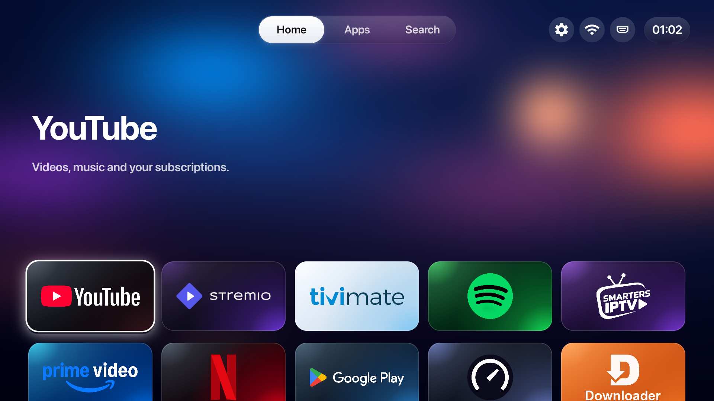
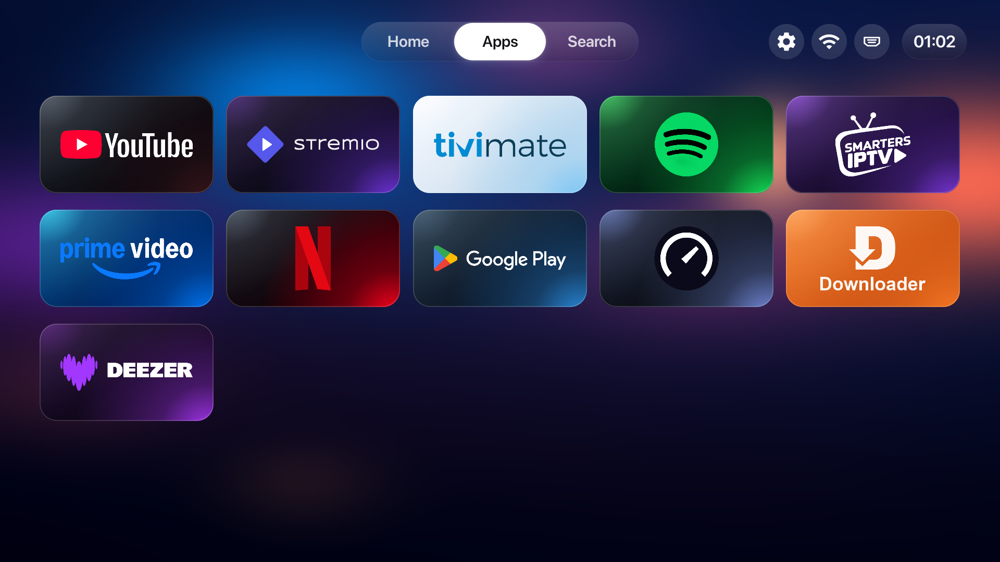
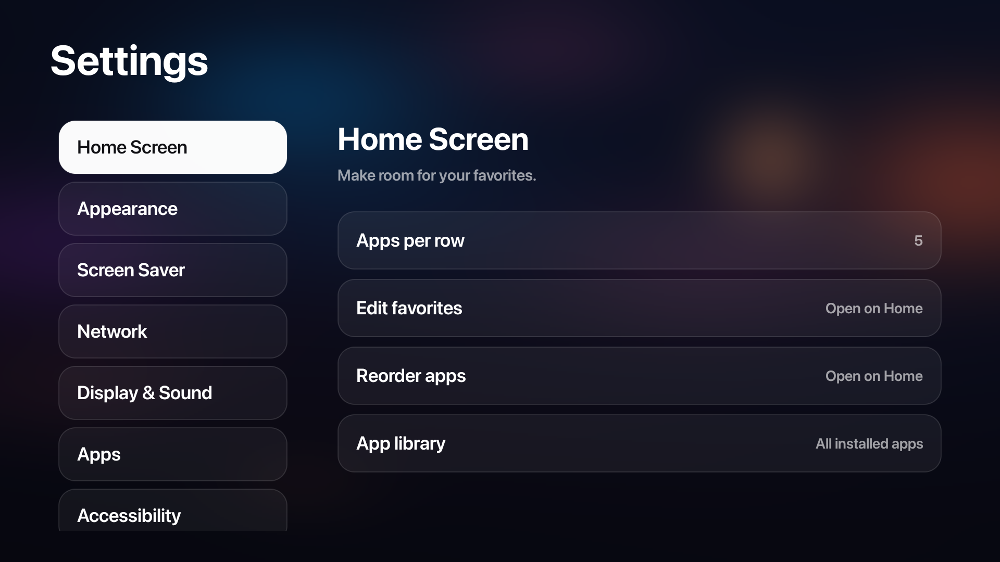
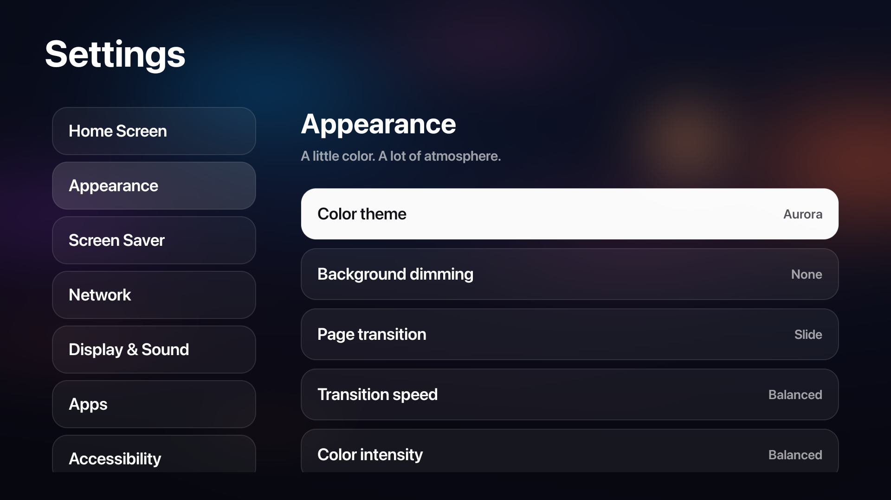
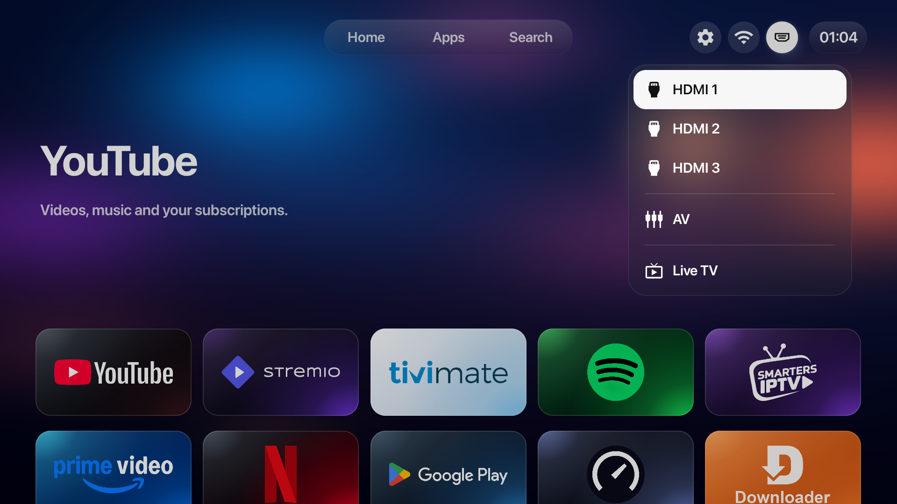
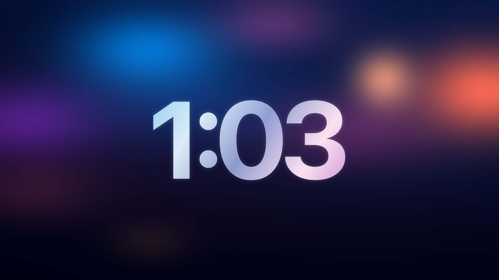

<p align="center">
  
</p>

# MiOS Launcher



**A clean, customizable home for Android TV, inspired by Apple TV.**

[Download APK](https://github.com/abdemeh/MiOS-Launcher/releases/latest/download/MiOS-Launcher.apk) ? [Releases](https://github.com/abdemeh/MiOS-Launcher/releases) ? [Build / move to another PC](TRANSFER-GUIDE.md)

**Version 6.10.21** ? Android 8.0+ (API 26+) ? Tested on Xiaomi MiTV-MOOR2, Android 11.

MiOS Launcher replaces the home experience with rounded app cards, a blurred color background, smooth remote navigation and a configurable clock screensaver. It runs on the TV's existing Android firmware. It does not install a new operating system or require root.

## Download

- **[Download MiOS-Launcher.apk directly](https://github.com/abdemeh/MiOS-Launcher/releases/latest/download/MiOS-Launcher.apk)**
- [Download this version (6.10.21)](https://github.com/abdemeh/MiOS-Launcher/releases/download/v6.10.21/MiOS-Launcher.apk)
- SHA-256 checksums are attached to each release.

### Downloader code

**`9948268`**

Open Downloader on your TV, enter **9948268** in its URL/code field, and follow the download and installation prompts. You can also use the direct APK link above.

## What you get

- A shared app selection: **Home** displays the first two rows; **Apps** displays all selected apps in the same order.
- A checklist to show/hide installed apps. Unchecking hides an app from Home and Apps without uninstalling it; check it again to restore it.
- Home / Apps tabs that switch on focus, with a short delay and animated transitions.
- Dark, brand-colored cards, a small focus zoom and a white focus glow. Long-press an app for Move, App info and, for removable apps, Uninstall.
- Settings, network and input controls, including HDMI connection indicators.
- Ten color themes: Aurora, Ocean, Violet, Sunset, Emerald, Rose, Amber, Glacier, Graphite and Midnight.
- Typography, background dimming, transition and clock/screensaver customization.
- A launcher home without sponsored content rows. Ads inside other apps are controlled by those apps.

## Screenshots

Captured directly from the Xiaomi test TV. Installed apps and preferences shown here are examples; they are not bundled with the launcher.

| Home | Apps |
| --- | --- |
|  |  |

| Settings | Themes |
| --- | --- |
|  |  |

| Inputs | Clock screensaver |
| --- | --- |
|  |  |

## Install on your TV

### Option 1: install the APK on the TV

1. Download **MiOS-Launcher.apk** using the link above. You can use Downloader on the TV, a USB drive or a file-transfer app.
2. Allow **Install unknown apps** for the browser/file manager you use. The exact setting name varies by TV.
3. Open the APK and choose **Install**. If you already have this project's earlier Home/CleanYourTV build, choose the update option to keep preferences.
4. Open **MiOS Launcher** from the TV's app list.
5. If your TV offers **Default apps ? Home app**, choose MiOS Launcher. Otherwise see the Home-button section below.

Only the launcher is included. Install your streaming/music/IPTV apps separately using Play Store or their official distribution.

### Option 2: install from a PC using ADB

1. Install Android **Platform Tools** on the PC and connect it to the same local network as the TV.
2. On the TV, open **Settings ? About**, press the Android TV OS build entry seven times, then enable **USB debugging** in Developer options. Enable network/ADB debugging too if your TV has that option.
3. Find the TV's IP address in network settings. Replace `TV_IP` below with it.
4. Run these commands from the folder containing the downloaded APK and accept the debugging prompt on the TV:

```powershell
adb connect TV_IP:5555
adb -s TV_IP:5555 install -r MiOS-Launcher.apk
adb -s TV_IP:5555 shell am start -n com.gathin.tvhome/.MainActivity -a android.intent.action.MAIN -c android.intent.category.HOME
```

These commands apply to TVs exposing classic network ADB. If your TV uses **Wireless debugging** with pairing, use its displayed pairing/connection addresses and ports instead.

The internal package remains `com.gathin.tvhome` for compatibility with earlier builds. Update with `install -r`; do not uninstall to fix a signing-key mismatch.

### Make the Home button open MiOS Launcher

- Prefer the TV's default Home-app setting when available.
- Some Xiaomi / Google TV firmware keeps returning to stock Google Home. MiOS includes an optional **Home override** accessibility service: enable it in the TV's Accessibility settings and accept Android's warning if you want this behavior.
- The override observes Google TV Home window changes; screen-content retrieval is disabled. It is designed for `com.google.android.apps.tv.launcherx`, so other stock launchers may need device-specific setup.
- Keep a stock launcher/recovery path installed. Installing the APK alone does not disable Xiaomi system apps or automatically configure accessibility.

### Set up the screensaver

Open **Settings ? Screen Saver** in MiOS to choose the clock font, weight, size, color style and position. Use **Preview** to see it. For automatic idle activation, choose the launcher's **Clock** service in the TV's system screensaver settings and set the idle timeout there.

## Use the remote

| Action | Control |
| --- | --- |
| Browse Home / Apps | Focus the tab; it activates automatically |
| Enter app cards | Down from a browse tab |
| Open an app | OK on its card |
| App actions / reorder | Hold OK on a card |
| Choose visible apps | Settings ? Home Screen ? Edit favorites; OK checks/unchecks |
| Change colors | Settings ? Appearance ? Color theme |
| Switch inputs | HDMI button in the top-right controls |
| Configure the clock | Settings ? Screen Saver |

Settings, Wi-Fi, Inputs and Search require OK to open. Hiding Live TV in the checklist only hides its tile; it does not remove tuner or input services.

## Compatibility and cleanup

The app targets Android TV / Google TV. Android 8.0+ is the minimum; the verified test device is Xiaomi MiTV-MOOR2 on Android 11. Input controls, CEC, hardware settings and default-home behavior depend on the TV firmware. Other models require their own checks; this is not a claim that every TV is supported.

Optional device cleanup is separate from the APK. Follow the keep-list workflow in [TRANSFER-GUIDE.md](TRANSFER-GUIDE.md): inventory the exact model, save original package states and remove only verified unnecessary apps. Keep **Live TV, tuner/channel services, input switching, HDMI/HDR/CEC, audio, networking, Play Store and recovery services**. Do not apply a Xiaomi package list blindly to another TV.

## Build and customize

See [TRANSFER-GUIDE.md](TRANSFER-GUIDE.md) for JDK 17, Python 3, SDK 34 / Build Tools 34.0.0 and the supplied PowerShell build command. Source is in `clean-your-tv/launcher`; the build runs unit tests and lint.

- App artwork: `assets/app-icons/*.svg`; package mappings: `assets/app-icons/apps.json`.
- Launcher branding: `assets/branding/icon.png` and `assets/branding/banner.png`.
- Background recipe: `assets/backgrounds/aurora.json`.
- Build/asset scripts: `tools/`.

The private signing key, local TV records, SDK/JDK/ADB binaries, caches and generated APKs are excluded from Git. To update an existing install from another PC, transfer the original signing key privately as described in the guide. Third-party brand artwork/fonts retain their respective ownership and licensing; the MIT software license does not relicense them.

## Credits

MiOS Launcher is **based on and inspired by [Gathin23/cleanyourtv](https://github.com/Gathin23/cleanyourtv)**. Thank you to Gathin for the original launcher and Android TV tooling. This project adapts that foundation with its own UI, navigation, themes, artwork mapping and Xiaomi TV customization.

The software retains the upstream [MIT license](LICENSE) and copyright notice. MiOS Launcher is an independent project and is not affiliated with Xiaomi or Apple. App names/logos belong to their respective owners.
